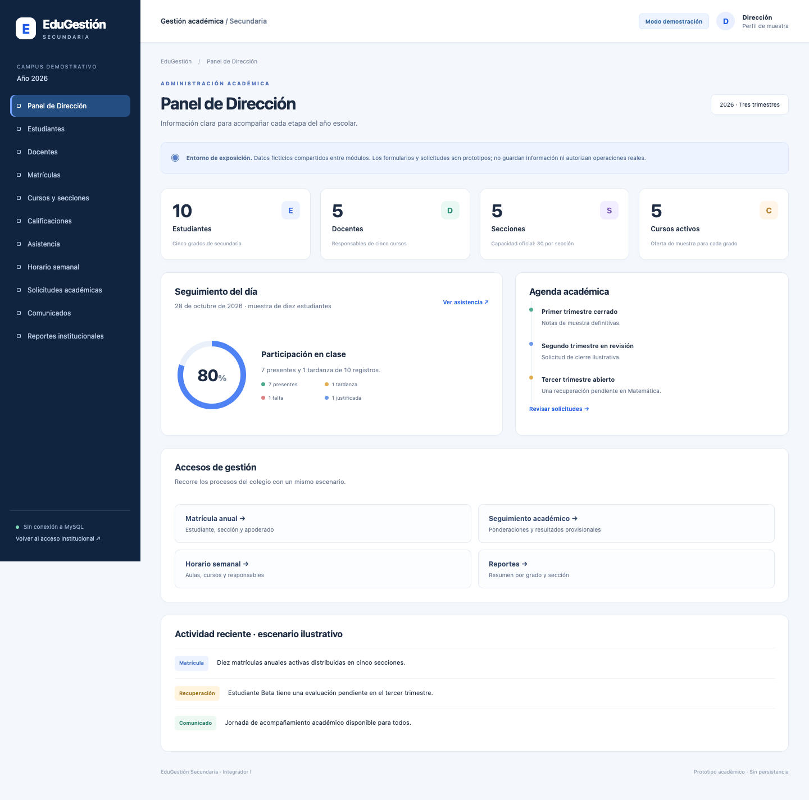
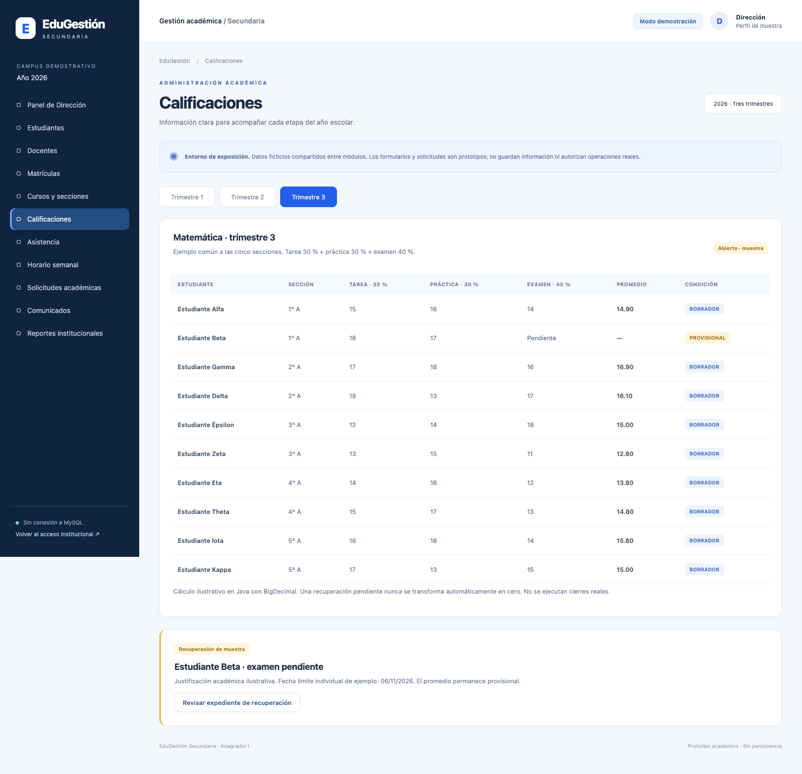

# EduGestión Secundaria

Sistema web académico para educación secundaria, desarrollado para Integrador I con **Java 8, Java EE 7, JSP, Servlets, DAO y JDBC**. La entrega actual incluye una **demostración pública de solo lectura**, integrada en el mismo WAR y sin conexión a MySQL.

> La demo utiliza únicamente datos ficticios. No representa un sistema listo para producción ni implementa todavía la base `educagestion` o el modelo propuesto de 37 tablas.

## Abrir la demostración

Con GlassFish iniciado y el WAR desplegado:

**http://127.0.0.1:8080/WebEducativa/demo/inicio**

También se puede abrir `http://127.0.0.1:8080/WebEducativa/` y seleccionar **Explorar demostración sin credenciales**. No introduzcas cuentas o contraseñas reales. La demo no autentica usuarios ni crea sesiones institucionales. El encabezado «Dirección / Perfil de muestra» representa exclusivamente la presentación.

Publicar el código en GitHub **no aloja ni ejecuta** esta aplicación Java EE. El navegador necesita el servidor local.

## Objetivo

Presentar de manera clara la gestión de estudiantes, docentes, matrícula anual, cursos, secciones, evaluación, asistencia y comunicación institucional. Los procesos futuros contemplan tres trimestres, autorizaciones específicas y conservación del historial académico.

## Pantallas disponibles

Todas las rutas siguientes parten de `/WebEducativa/demo/`:

| Ruta | Contenido e interacciones |
|---|---|
| `inicio` | Indicadores de 10 estudiantes, 5 docentes, 5 secciones y 5 cursos; agenda y accesos rápidos |
| `estudiantes` | Búsqueda por nombre/código, filtros por grado/estado, ficha `?detalle=1`, formulario visual |
| `docentes` | Búsqueda por nombre/especialidad y detalle `?detalle=1` |
| `matriculas` | Matrícula anual 2026, sección y apoderado principal de muestra |
| `cursos` | Cursos, responsables, primero a quinto, capacidad oficial y ocupación |
| `calificaciones` | Selector `?trimestre=1`, `2` o `3`; ponderación 30/30/40; resultado provisional sin nota cero |
| `asistencia` | Registro fijo del 28/10/2026, búsqueda y filtro por estado |
| `horarios` | Rotación semanal de un bloque diario, filtrable por sección |
| `solicitudes` | Prototipos informativos de cierre, recuperación y corrección |
| `anuncios` | Comunicados ilustrativos y enlaces de seguimiento |
| `reportes` | Resumen de matrícula, ocupación y accesos a notas/asistencia/horario |

Los botones de funciones no implementadas muestran un aviso. El formulario de muestra valida campos y muestra una notificación, **sin cambiar el catálogo ni persistir datos**. Recargar conserva el escenario original. El horario es un bloque ilustrativo, no desarrolla las cuatro horas semanales declaradas por curso.

## Tecnologías y requisitos

- JDK **8** completo; validado localmente con Zulu `1.8.0_512`, ARM64.
- Apache Ant **1.10.15 o posterior compatible con Java 8**; validado con 1.10.18.
- GlassFish **4.1.1 Web Profile**, con sus API `javax.*`.
- Connector/J **26.10.0** externo, incluido en el WAR por el build; la demo no lo utiliza para conectar.
- Navegador moderno con JavaScript, CSS Grid y soporte de `dialog`.
- MySQL 8.4 es el objetivo de integración posterior: **no es necesario iniciarlo para esta entrega**.

Bootstrap 5.3.3, utilizado por las vistas existentes, está conservado localmente en `web/assets/vendor/bootstrap/`, con su licencia MIT. La demo usa sus propios estilos y JavaScript locales. No necesita servicios CDN ni fuentes externas.

## Arquitectura actual

```text
Navegador → DemoServlet → DatosDemo (catálogo ficticio inmutable)
                      → JSP protegida en WEB-INF/vistas/demo
                      → CSS y JavaScript locales

Rutas institucionales conservadas:
Servlets → DAO → JDBC → MySQL (integración pendiente y acceso bloqueado)
```

`src/java/Demo/DatosDemo.java` centraliza los datos y el cálculo ilustrativo con `BigDecimal`. `DemoServlet` acepta únicamente pantallas permitidas; no usa DAO ni atributos de autenticación. Las escrituras POST de demo devuelven 405.

`ProduccionPendienteFilter` bloquea `/login` y `/app/*` mientras falta integrar y validar los flujos reales. Según el orden de filtros del contenedor, una petición no autenticada a `/app/*` puede redirigirse primero al inicio. No debe alcanzar un DAO ni ejecutar modificaciones. No existe una variable de entorno que elimine este bloqueo.

`CabecerasSeguridadFilter` aplica CSP, protección frente a incrustación, `nosniff` y política de referencia. Es defensa adicional, no certificación de seguridad de producción.

## Arquitectura futura

El modelo de **37 tablas es una propuesta, no una migración implementada**. Prevé personas y perfiles, años y tres trimestres, adscripciones históricas de sección, responsables docentes sucesivos, notas versionadas, cierres autorizados, recuperaciones, excepciones de cupo y auditoría transversal.

Se necesita una capa de servicios transaccionales entre Servlets y DAO. El SQL preliminar de 17 tablas y las propuestas posteriores son antecedentes de diseño; no se han aplicado a MySQL. Deben resolverse las decisiones académicas pendientes antes de implementarlas.

## Preparar el entorno en macOS

Instala las distribuciones oficiales de JDK 8, Ant y GlassFish por separado. No hay instalación automática ni descargas durante el build. Sustituye las rutas si tu instalación difiere.

```sh
export JAVA8_HOME="$(/usr/libexec/java_home -v 1.8)"
export JAVA_HOME="$JAVA8_HOME"
export AS_JAVA="$JAVA8_HOME"
export PATH="$JAVA8_HOME/bin:$PATH"
export ANT_HOME="/opt/homebrew/opt/ant/libexec"
export GLASSFISH_HOME="$HOME/tools/edugestion/glassfish-4.1.1/glassfish4/glassfish"
export EDUGESTION_JDBC_JAR="$HOME/tools/edugestion/jdbc/mysql-connector-j/26.10.0/mysql-connector-j-26.10.0.jar"
```

Son variables temporales de la terminal. Para ejecutar las tareas de VS Code, inicia VS Code desde ese entorno. No guardes rutas personales o secretos en configuraciones compartidas.

El runtime de la extensión Java de VS Code es independiente del JDK 8 con el que se compila la aplicación.

### Controlador JDBC externo

Obtén `com.mysql:mysql-connector-j:26.10.0` de Maven Central o MySQL. El JAR no se versiona.

SHA-256 esperado:

```text
cef70caf532833c9ab8f41f74773ce22c08bf503fad215c9c2ee1e9db87e759e
```

Se puede sustituir la ruta usando `-Dmysql.connector.jar=/ruta/al/jar`. La versión y su checksum están fijados: un cambio exige revisión explícita, no renombrar otro JAR para eludir la comprobación.

## Compilar con Ant

Desde la raíz del repositorio:

```sh
"$JAVA8_HOME/bin/java" -jar "$ANT_HOME/lib/ant-launcher.jar" -f build-vscode.xml verify
"$JAVA8_HOME/bin/java" -jar "$ANT_HOME/lib/ant-launcher.jar" -f build-vscode.xml demo-test
"$JAVA8_HOME/bin/java" -jar "$ANT_HOME/lib/ant-launcher.jar" -f build-vscode.xml war
```

Salida: **`dist-vscode/WebEducativa.war`**. Las clases se generan en `.dev-build/`; las JSP se procesan al solicitarlas a GlassFish. El build no inicia servicios, no ejecuta SQL ni despliega automáticamente.

## Desplegar localmente

Antes de arrancar, configura **todos** los listeners del dominio en `127.0.0.1`, incluidos administración e IIOP; mantén JMX remoto deshabilitado. No uses el dominio original abierto en todas las interfaces.

```sh
"$GLASSFISH_HOME/bin/asadmin" start-domain --debug=false domain1
"$GLASSFISH_HOME/bin/asadmin" --interactive=false --host 127.0.0.1 --port 4848 \
  deploy --upload=true --force=true --name WebEducativa \
  --contextroot /WebEducativa "$PWD/dist-vscode/WebEducativa.war"
```

`--force=true` reemplaza solo el despliegue local llamado `WebEducativa`. Comprueba el nombre antes de usarlo. `--upload=true` evita depender del acceso del proceso servidor a la carpeta Documents en macOS. Si el sistema solicita acceso a archivos, decide desde el diálogo local; no desactives protecciones.

Abre **http://127.0.0.1:8080/WebEducativa/demo/inicio**. Para detener:

```sh
"$GLASSFISH_HOME/bin/asadmin" stop-domain domain1
```

No se configura inicio automático. La demo puede permanecer activa durante la exposición únicamente en localhost.

## Qué está implementado y qué está simulado

**Implementado:** WAR Java EE, catálogo común ficticio, navegación entre once módulos, render JSP/JSTL, búsquedas/filtros en navegador, fichas, cálculo demostrativo ponderado, estados visibles y bloqueo de flujos institucionales.

**Simulado:** nombres, matrículas, responsables, cifras, asistencia, cierres, recuperación y actividad reciente. Un aviso de botón no representa una autorización ni un cambio académico.

**Pendiente:** base `educagestion`, servicios transaccionales, identidad documental, matrícula y traslado reales, auditoría, horarios completos y validación concurrente, principales obligatorios, cierres y correcciones autorizadas, promedios institucionales, reportes filtrados contra MySQL y credenciales seguras.

PDF/Excel, recuperación por correo y aplicaciones móviles no forman parte de esta entrega.

## Seguridad y limitaciones conocidas

- El código institucional antiguo conserva SHA-256 sin sal, eliminaciones por GET, validaciones parciales y una configuración JDBC que requiere revisión. Sus rutas están bloqueadas en esta entrega; **no retirar el filtro para una exposición**.
- No hay autenticación real en la demo; es pública porque contiene solo datos sintéticos de lectura.
- No utilizar datos reales en los formularios de muestra.
- Los almacenes de certificados del GlassFish antiguo contienen certificados caducados. No se afirma que HTTPS esté validado; no desactivar comprobaciones para ocultar el problema.
- Se observaron advertencias de `Http2AddOn` y limpieza del driver JDBC. No impidieron las pruebas HTTP de esta entrega.
- MySQL y la cuenta root no intervienen en la demo. No utilizar root como cuenta futura de aplicación.
- Bootstrap incluye referencias a mapas de código fuente opcionales para herramientas de desarrollo; no son necesarios para ejecutar la interfaz.
- El historial académico y las autorizaciones descritos en el informe no deben confundirse con implementación real.

## Revisión para el docente

1. Ejecutar `verify`, `demo-test` y `war`.
2. Entrar sin credenciales desde el inicio público.
3. Recorrer estudiantes → detalle → matrículas → cursos.
4. Cambiar entre los tres trimestres: en el tercero, Estudiante Beta queda provisional.
5. Revisar asistencia y el horario filtrado por sección.
6. Abrir solicitudes: las acciones muestran que son prototipos.
7. Leer las clases `Demo` y los filtros, con JavaDoc y separación de responsabilidades.
8. Contrastar las funciones simuladas con `docs/DEMO.md` y el diseño académico pendiente.

## Licencias

Bootstrap 5.3.3 conserva su licencia en `web/assets/vendor/bootstrap/LICENSE`. Esta entrega no añade una licencia general para el código del proyecto: su publicación no implica una licencia de reutilización no acordada por sus autores.

## Capturas reales de la demostración





[Vista móvil a 390 px](docs/screenshots/movil.png). Capturadas en Chrome headless contra el WAR desplegado localmente.
